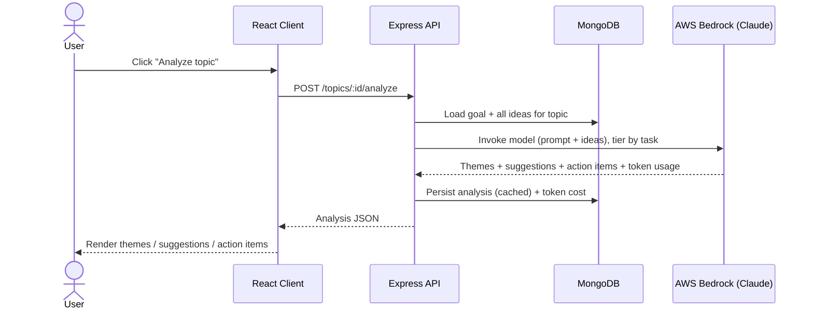

# Architecture — Brainwave

This document is how we reason about the system, not just how it's wired. It uses the same decision-record discipline we teach: for each choice, the problem, the option picked, and the judgment call (why this, not the alternative).

## System overview

```mermaid
flowchart LR
  subgraph client["Client"]
    UI["React + Vite SPA"]
  end

  subgraph server["Node + Express API"]
    Auth["Auth / sessions (OAuth)"]
    Core["Topics & Ideas service"]
    AI["AI analysis service"]
    Sync["Jira sync service"]
  end

  DB[("MongoDB&#10;orgs · users · topics&#10;ideas · action items")]
  Bedrock[["AWS Bedrock&#10;Claude (Haiku / Sonnet / Opus)"]]
  Jira[("Jira Cloud&#10;REST + webhooks")]
  IdP["Google / GitHub (OAuth)"]

  UI -->|"REST / JSON"| server
  Auth --> IdP
  Core --> DB
  AI --> DB
  AI -->|"invoke model"| Bedrock
  Sync --> DB
  Sync <-->|"REST + webhooks"| Jira
```

## The core flow: analyzing a topic

## Technologies

| Concern | Choice | Notes |
|---|---|---|
| Frontend | React + Vite | SPA, fast dev server |
| Backend | Node + Express | REST API |
| Data | MongoDB (Atlas) | document-shaped data; Atlas Vector Search for RAG in a later phase — no second datastore |
| LLM access | **AWS Bedrock** via the AnthropicBedrock SDK | one IAM-governed provider; HIPAA-eligible under an AWS BAA; no scattered vendor keys |
| Models | Claude **Haiku 4.5 / Sonnet 4.6 / Opus 4.8**, tier-routed | match model cost to task difficulty |
| Embeddings (later) | Bedrock embeddings (Titan / Cohere) | same single-provider path; `embeddings.js` sibling of `claude.js` |
| Auth | OAuth 2.0 (Google / GitHub) | third-party login; no password storage |
| Integrations | Jira Cloud REST + webhooks | two-way sync (Phase 4) |
| Dev agent | Claude Code (canonical), GitHub Copilot (optional) | how we build, and how we teach building |
| Infra (later) | AWS | Bedrock region + deploy target |

## LLM model routing

Don't pay Opus prices for work Haiku does well. The AI service routes by task:

| Task | Model | Why |
|---|---|---|
| Idea clustering / quick summary | Claude Haiku 4.5 | cheap, fast, high volume |
| Topic analysis → action items | Claude Sonnet 4.6 | strong reasoning at moderate cost (the default) |
| Hardest synthesis / conflict reasoning (later) | Claude Opus 4.8 | maximum reasoning when it actually pays off |
| Semantic search over topic history (later) | Bedrock embeddings | RAG retrieval |

Every model call records token usage so cost is visible from day one (and feeds the cost dashboard later).

## Decision record

| # | Decision | Choice | Judgment (why this, not the alternative) |
|---|---|---|---|
| D1 | LLM provider path | Claude via **AWS Bedrock** | One governed provider with IAM creds and a HIPAA-eligible path, vs. a raw API key per developer. Enterprise-ready and auditable. |
| D2 | Model selection | Tier-routed (Haiku / Sonnet / Opus) | Cost scales with task. A single big model everywhere wastes money on easy work and caps quality on hard work. |
| D3 | Datastore | MongoDB (Atlas) | Topics/ideas are document-shaped. Atlas Vector Search lets us do RAG later without standing up a second datastore. |
| D4 | Jira integration | Open-source connector | Commodity plumbing — MIT, reusable, not methodology. Keeping it open is the whole point of open-core. |
| D5 | Auth | OAuth, no passwords | Offload credential security to identity providers. Faster to ship, safer to operate. |
| D6 | Prompts | Versioned in source (`server/lib/prompts.js`) | Prompts are code: reviewed in PRs, diffable, rolled back like anything else. Never inline strings. |
| D7 | Tenancy | Org → users, data scoped per org (Phase 2) | SaaS from the start. Retrofitting multi-tenancy onto a single-tenant app is painful; we design for it even though Phase 1 ships single-workspace. |

> **Note for contributors:** these are the kinds of decisions you'll write yourself in PR descriptions — Problem → CS pattern → Architecture → Judgment. The skill isn't reaching for the fanciest option; it's knowing when *not* to.
